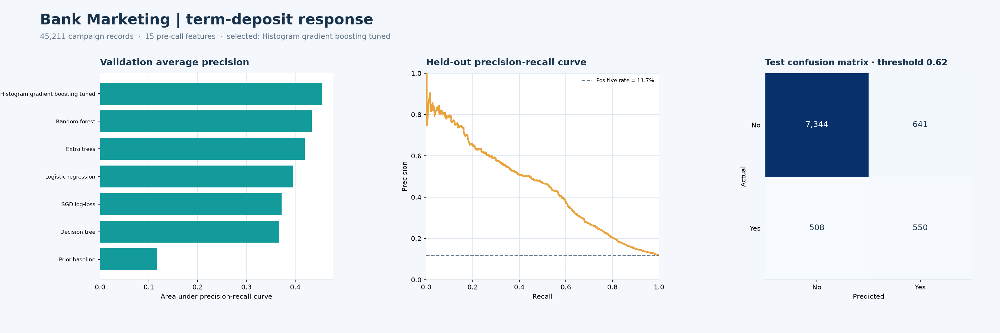
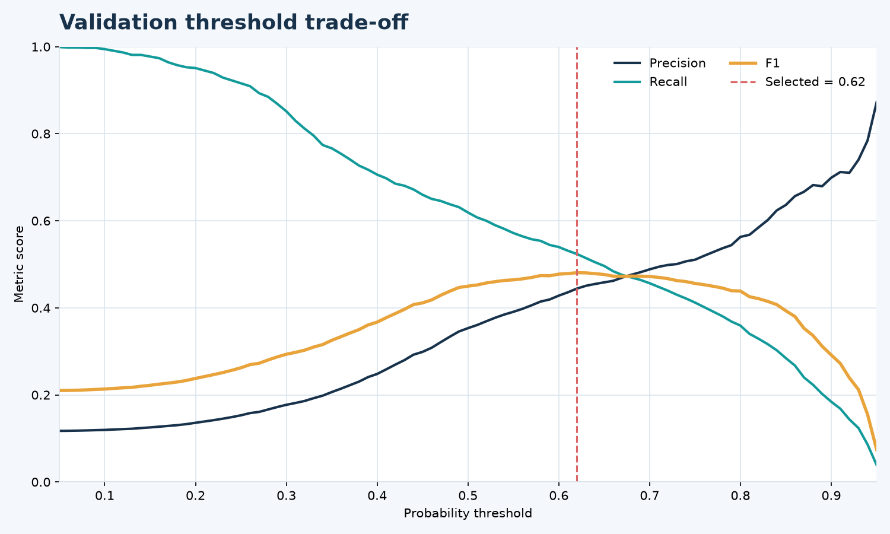
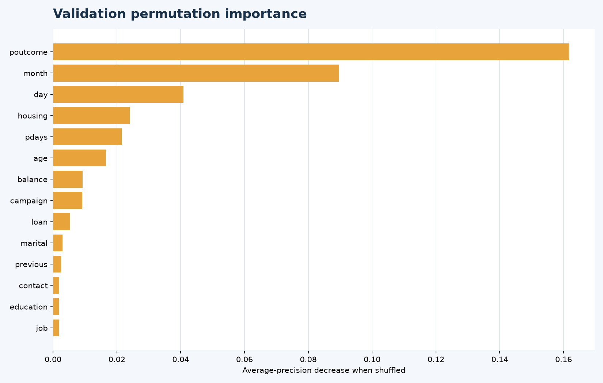
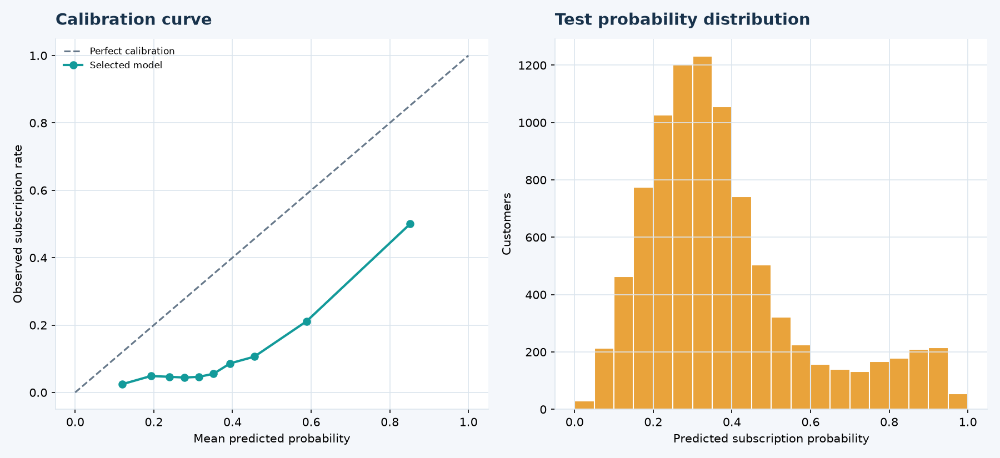

# Bank Marketing: Term Deposit Prediction

## Goal

Estimate whether a customer subscribed to a term deposit during a Portuguese bank's phone campaign. This updated project compares multiple models and makes the classification threshold explicit for an imbalanced target. It is an educational benchmark, not a contact-selection system.

## Data preparation and leakage controls

- Use UCI's `bank-full.csv`: 45,211 rows and 16 source predictors plus the target.
- Trim text, normalize the `yes`/`no` labels, remove exact duplicate records, and turn 52,124 `unknown` category values into missing values for imputation inside each training pipeline.
- Keep six numeric and nine categorical pre-call features; impute within the pipeline, scale numeric inputs for linear models, and one-hot encode categorical inputs.
- Exclude `duration`: call length is known only after the call and leaks information into a pre-call prediction scenario.
- Split the data with stratification into 60% training, 20% validation, and 20% test. The test set is held aside until model and threshold selection are complete.

## Models and selection

Seven classifiers are benchmarked: a prior-only baseline, logistic regression, SGD with log loss, decision tree, random forest, extra trees, and tuned histogram gradient boosting. Hyperparameters for histogram gradient boosting are searched across seven configurations with stratified 3-fold cross-validation on the training split. Average precision is used to compare models because only 11.7% of the labels are positive.

The tuned histogram gradient boosting model ranked first on validation average precision. A probability threshold is selected on validation to maximize F1; the final fitted model and selected threshold are saved together. The test set is evaluated once with that fixed threshold.

## Results

On the untouched test set, the selected model achieved **ROC-AUC 0.791**, **average precision 0.451**, and **F1 0.489** at the validation-selected threshold of **0.62**. At the default 0.50 threshold, test F1 is 0.450 with recall 0.609, illustrating the precision/recall trade-off. The positive-class baseline average precision is about **0.117**.

At threshold 0.62, the test confusion matrix has 7,344 true negatives, 641 false positives, 508 false negatives, and 550 true positives. Full metrics, the threshold choice, and split details are in [`artifacts/metrics.json`](artifacts/metrics.json); model scores are in [`artifacts/validation_leaderboard.csv`](artifacts/validation_leaderboard.csv).



### Threshold trade-off



### Feature importance

Permutation importance is measured on the validation split. It describes model sensitivity, not a causal effect.



### Probability calibration

The class-weighted model's scores are not perfectly calibrated. Treat them as ranking scores; calibrate on a dedicated validation sample before interpreting an individual score as a real-world subscription probability.



Test predictions and per-class results are saved in [`artifacts/test_predictions.csv`](artifacts/test_predictions.csv) and [`artifacts/classification_report.json`](artifacts/classification_report.json). The fitted model and decision threshold are in [`artifacts/bank_marketing_model.joblib`](artifacts/bank_marketing_model.joblib).

## Run

From the repository root:

```bash
python -m pip install -r requirements.txt
python projects/bank-marketing/src/train.py
```

The script downloads and caches the UCI archive in the ignored `data/raw/` folder, writes the cleaned table under `data/processed/`, saves the tuning results and model artifacts, and regenerates the four charts. Add `--retune` to repeat the hyperparameter search instead of reusing the saved search results.

## Data source and limits

Moro, S., Rita, P., & Cortez, P. (2014). [Bank Marketing, UCI Machine Learning Repository](https://doi.org/10.24432/C5K306). Dataset license: CC BY 4.0.

The data reflects historical campaign outcomes and selection patterns. Validation F1 is not a measure of business value: outreach costs, customer consent, and the value of a subscription are not modeled. The test score does not establish fairness or suitability for operational targeting.
