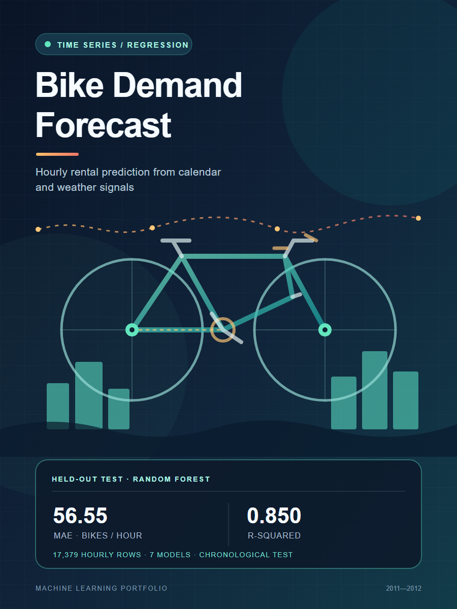
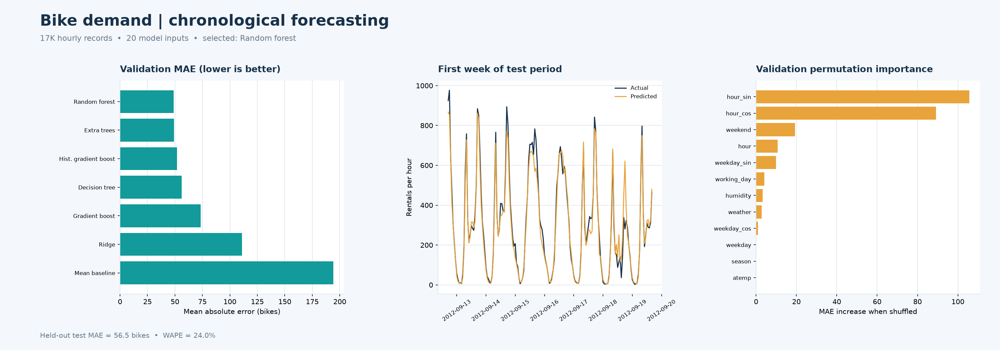
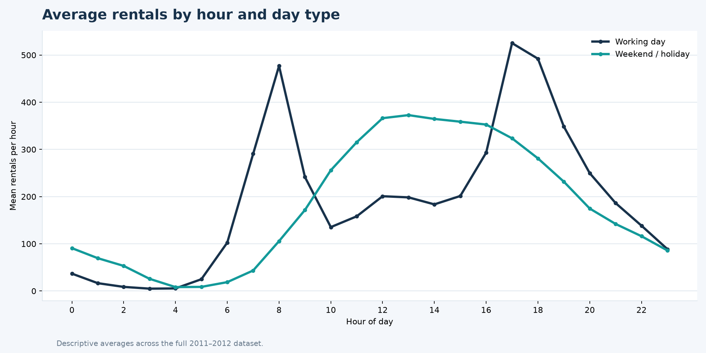
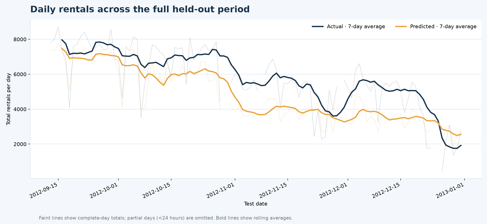
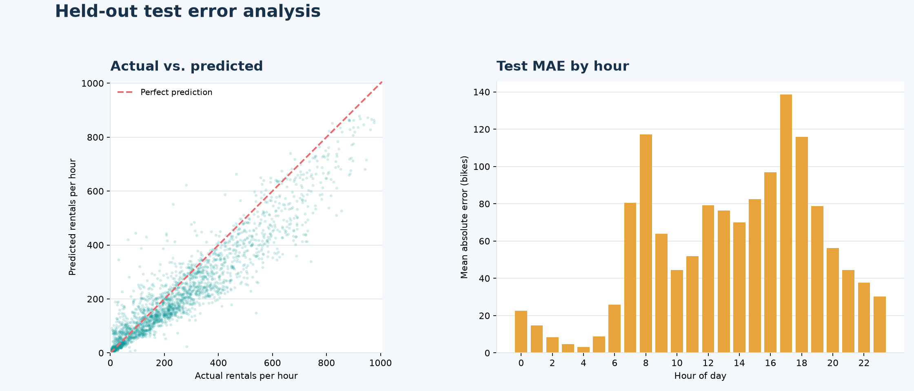
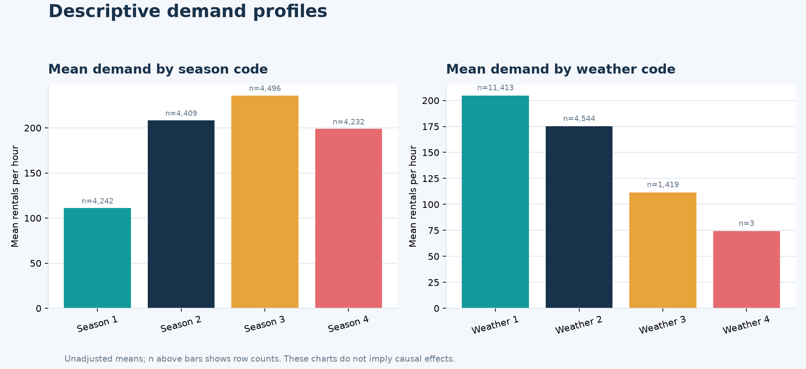

# Bike Demand Forecasting (Hourly)



Editable vector artwork: [`images/cover.svg`](images/cover.svg).

## Goal

Forecast the total number of bikes rented in an hour from calendar and weather information. This is a new project in the portfolio and uses a chronological holdout so the test set comes strictly after training and validation in time.

The UCI hourly file contains **17,379 observations** from 2011-01-01 through 2012-12-31. The model starts from 12 usable source signals and adds 8 calendar features, for 20 input columns. The target is `cnt`.

## Cleaning and leakage controls

- Download the official UCI archive when the script is first run; keep raw and processed files local and ignored by Git.
- Parse the date and hour into a timestamp, sort observations chronologically, remove exact duplicate rows, and drop rows without a timestamp or target.
- Validate that the target is nonnegative and that `cnt = casual + registered` in the source.
- Exclude `instant`, `casual`, and `registered` from model inputs. The latter two reveal the target directly because they sum to `cnt`.
- Encode hour, weekday, and annual calendar position with sine/cosine features; add weekend and a year trend. One-hot encode categorical calendar and weather fields inside each model pipeline.
- Use the first 70% for training, the next 15% for validation, and the final 15% as a one-time chronological test period.

## Models

Seven regression baselines and model families are compared: mean baseline, Ridge, Decision Tree, Random Forest, Extra Trees, Gradient Boosting, and tuned HistGradientBoosting. The histogram gradient model is tuned with seven randomized configurations and three expanding-window `TimeSeriesSplit` folds using MAE. The winning model is selected by validation MAE, then refit on train plus validation before test evaluation.

## Results

Random Forest had the lowest validation MAE (**48.85 bikes/hour**). On the later, held-out test period it achieved **MAE 56.55**, **RMSE 83.27**, **R² 0.850**, and **WAPE 24.0%**.

| Validation model | MAE | RMSE | R² |
|---|---:|---:|---:|
| Random forest | 48.85 | 76.57 | 0.882 |
| Extra trees | 49.13 | 75.55 | 0.885 |
| Histogram gradient boosting tuned | 51.94 | 76.92 | 0.881 |
| Decision tree | 56.09 | 89.64 | 0.839 |
| Gradient boosting | 73.39 | 100.30 | 0.798 |
| Ridge regression | 111.08 | 142.10 | 0.595 |
| Mean baseline | 194.14 | 253.97 | -0.294 |

The strongest validation permutation signals were hour-of-day and weekend features. The chart compares validation errors, shows one test week, and summarizes feature importance.



Full metric and split details are in [`artifacts/test_metrics.json`](artifacts/test_metrics.json), the complete leaderboard is in [`artifacts/validation_leaderboard.csv`](artifacts/validation_leaderboard.csv), and test predictions are in [`artifacts/test_predictions.csv`](artifacts/test_predictions.csv). The fitted model is [`artifacts/bike_demand_model.joblib`](artifacts/bike_demand_model.joblib).

## Additional visualizations

The supplementary figures are generated with `python projects/bike-demand-forecast/src/plot_analysis.py`.

### Demand by hour and day type



### Full chronological test period

This shows daily totals and rolling averages across the held-out period. Partial days with fewer than 24 observations are omitted from the daily comparison.



### Test error analysis



### Season and weather summaries

These are unadjusted averages; sample counts appear above each bar.



## Run

From the repository root:

```bash
python -m pip install -r requirements.txt
python projects/bike-demand-forecast/src/train.py
python projects/bike-demand-forecast/src/plot_analysis.py
```

The 3-fold tuning results are saved and reused on later runs. Add `--retune` to repeat the hyperparameter search. The plot script regenerates the four supplementary figures. Raw downloads and the engineered CSV are reproducible from the scripts and remain excluded from Git.

## Dataset citation and limits

Fanaee-T, H. (2013). [Bike Sharing Dataset, UCI Machine Learning Repository](https://doi.org/10.24432/C5W894). Dataset license: CC BY 4.0.

These observations describe Capital Bikeshare in 2011–2012. Weather features describe the target hour, so a real forecast would need weather forecasts available at prediction time. No station-level, event, or lagged rental features are used; results may not transfer to a different city or current demand patterns.
