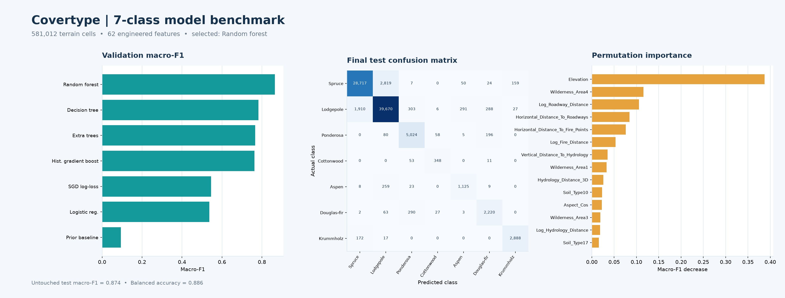

# Covertype Advanced: Multi-Model Forest Cover Classification

## Problem

Predict one of seven forest-cover types from cartographic measurements for 30 × 30 m land cells in Colorado. The UCI dataset contains 581,012 rows, 54 source features, no reported missing values, and a strongly imbalanced target. Features include elevation, slope, hydrology and road distances, hillshade, four one-hot wilderness-area flags, and forty one-hot soil-type flags.

This project expands the 54 source features to 62 model features with deterministic terrain and cyclical-angle engineering. It benchmarks seven model families on the same stratified 150,000-row sample, tunes histogram gradient boosting with stratified cross-validation, chooses a model on validation macro-F1, then refits the winner on a stratified sample of up to 200,000 train-plus-validation rows and evaluates it once on a held-out test set.

## Data preparation

- Download the official UCI archive at runtime; raw files are cached locally and excluded from Git.
- Validate the 7 target classes, numeric ranges, one-hot binary columns, and exactly one wilderness-area and soil-type flag per row.
- Keep duplicate observations because repeated cartographic profiles are valid samples in this dataset.
- Derive sine/cosine aspect, 3D distance to hydrology, mean and range of hillshade, and log-distance features.
- Use a stratified 70% train, 15% validation, and 15% test split. Fit scaling only within linear-model pipelines.
- Use a 15,000-row stratified sample for 3-fold hyperparameter search and the same 150,000-row stratified training sample for every benchmark model to make the comparison comparable and practical to run.
- Use class weighting for imbalanced classes where supported; use balanced sample weights for histogram gradient boosting.

## Models compared

1. Prior-only dummy baseline
2. Multinomial logistic regression
3. SGD classifier with log loss
4. Decision tree
5. Random forest
6. Extra trees
7. Histogram gradient boosting, with randomized hyperparameter search on a stratified training sample using 3-fold macro-F1 cross-validation

The validation leaderboard includes accuracy, balanced accuracy, macro-F1, weighted-F1, macro ROC-AUC, log loss, and fit time. The winner is retrained on train + validation data and scored on the untouched test split. Feature permutation importance, the class report, and confusion matrix are saved as artifacts.

## Results

Random Forest ranked first by validation macro-F1 (**0.8645**). On the untouched test set it reached **91.78% accuracy**, **0.8856 balanced accuracy**, **0.8740 macro-F1**, and **0.9933 macro ROC-AUC**.

| Validation model | Macro-F1 | Balanced accuracy | Macro ROC-AUC (OvR) |
|---|---:|---:|---:|
| Random forest | 0.8645 | 0.8685 | 0.9921 |
| Decision tree | 0.7826 | 0.8515 | 0.9360 |
| Extra trees | 0.7658 | 0.8855 | 0.9780 |
| Histogram gradient boosting | 0.7625 | 0.8800 | 0.9744 |
| SGD log-loss | 0.5460 | 0.6378 | 0.9253 |
| Logistic regression | 0.5365 | 0.7192 | 0.9299 |
| Prior-only baseline | 0.0936 | 0.1429 | 0.5000 |

The strongest permutation-importance signals were elevation, wilderness area, and distance-to-road/fire features. See [`artifacts/test_metrics.json`](artifacts/test_metrics.json), [`artifacts/validation_leaderboard.csv`](artifacts/validation_leaderboard.csv), and the dashboard below for full results.



## Run

From the repository root:

```bash
python -m pip install -r requirements.txt
python projects/covertype-advanced/src/train.py
```

This downloads the source data, writes the cleaned dataset under `data/processed/` (ignored by Git), and saves the model, metrics, leaderboard, class report, feature importance, confusion matrix, tuning results, and diagnostic image under `artifacts/` and `images/`. The saved 3-fold tuning results are reused on later runs; add `--retune` to run the search again.

## Dataset citation

Blackard, J. (1998). [Covertype, UCI Machine Learning Repository](https://doi.org/10.24432/C50K5N). Dataset license: CC BY 4.0. UCI describes the source as 581,012 observations and 54 features; its target classes are seven forest-cover types.

## Limitations

The data describes a particular study area in northern Colorado and uses historical cartographic observations. Scores should not be interpreted as ecological ground truth for other regions or current conditions. This project is for model-comparison practice, not land-management decisions.
