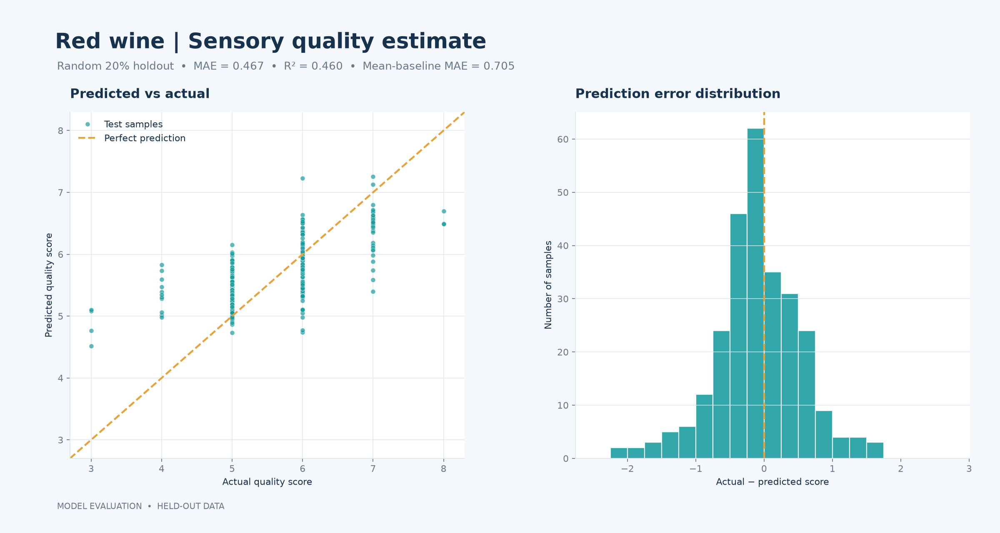

# Wine Quality: Physicochemical Regression

## Goal

Estimate the sensory quality score of red vinho verde samples from physicochemical measurements. The target is an ordinal score, so regression metrics summarize error but do not capture every consequence of being off by one versus several points.

## Data cleaning and modeling

- Download the UCI ZIP archive and parse `winequality-red.csv` with its semicolon delimiter.
- Normalize column names, coerce all fields to numeric, remove exact duplicates, and drop incomplete rows or target values outside the documented 0–10 range.
- Use a fixed random 80/20 split and fit a random forest regressor.
- Report MAE, RMSE, and R² alongside a mean-prediction baseline MAE.

Run from the repository root with `python projects/wine-quality/src/train.py`.

## Results

On a random 20% holdout, the model reached MAE **0.467**, RMSE **0.619**, and R² **0.460**. A constant-mean baseline scored MAE **0.705**. Full results are in [`artifacts/metrics.json`](artifacts/metrics.json).

## Data source

Cortez, P., Cerdeira, A., Almeida, F., Matos, T., & Reis, J. (2009). [Wine Quality, UCI Machine Learning Repository](https://doi.org/10.24432/C56S3T). Dataset license: CC BY 4.0.

## Limitations

The UCI data is a modest sample and only covers physicochemical measurements and sensory labels, not brand, vintage, or price. Results are for learning; they are not a guarantee of quality for commercial wine.
